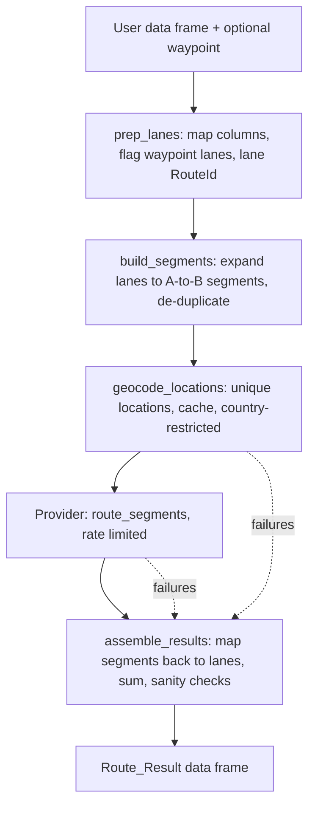

# Design Document: Phase 1 (Core Router, OpenRouteService, Waypoints, Geocoding)

## Overview

Phase 1 delivers a provider-neutral routing pipeline and one working provider, OpenRouteService (ORS), which can be developed and tested on a free account. It covers Requirements 1, 6, 9, 13 and 14, plus the key-reading parts of Requirement 7 (see Note D in `requirements.md`).

The central idea: **every provider only ever answers "route from point A to point B".** Everything else (column mapping, waypoint handling, de-duplication, geocoding, unit conversion, result assembly) is provider-neutral and lives in the package, not in a provider. This keeps providers small, makes adding Google, HERE and OSRM in Phase 3 mostly a matter of writing one adapter each, and means a provider changing its waypoint feature cannot affect results.

## Architecture



Existing `pcm_*` functions are left untouched and are not part of this pipeline (Note A). New code does not use the `pcm_` prefix.

## Components and Interfaces

### 1. `route()` (exported): the entry point

```r
route(df, waypoint = NULL, provider = truckr_get_provider(), ...)
```

- `df`: lanes with origin and destination columns, and optionally a logical `Use_Waypoint` column. The column can be omitted.
- `waypoint`: a single location applying to every lane where `Use_Waypoint` is TRUE. Accepts a zip/postal string, a "City, ST" string, a full address string, or `c(lat =, lon =)` coordinates. One waypoint value per call (Requirement 13.2, 13.4). A per-row waypoint column is a possible later extension and is out of scope.
- Argument handling is a small internal function, `resolve_waypoint_mode()`, run first so bad input fails before any API call (Requirement 13.1):

| `Use_Waypoint` column | `waypoint` | Result |
|---|---|---|
| absent | NULL | no waypoints; all lanes direct |
| present, has TRUE | supplied | TRUE lanes use the waypoint |
| present, has TRUE | NULL | error |
| present, no TRUE | NULL | all lanes direct, no error |
| present, no TRUE | supplied | all lanes direct, with a warning that the waypoint was not used |
| absent | supplied | error: add a `Use_Waypoint` column |
| present, not logical | any | error |

`resolve_waypoint_mode()` returns `mode` ("none" or "waypoint"), `use_waypoint` (a logical vector, one per row) and `waypoint` (NULL, or the parsed location). The parsed waypoint carries its `type` (`coordinates`, `address`, `zip` or `city_state`), a display `value`, and the components `street`, `city`, `state`, `zip`, `country`, `lat`, `lon`, so providers can apply their own geocoding strategy (Requirement 14.8). A bare string is classified automatically (five-digit or ZIP+4 and Canadian postal codes as `zip`; "City, ST" as `city_state`; anything else as a free-text `address`); coordinates must be named `lat` and `lon`; a named list or vector of components is also accepted, which is how to state a country explicitly. When the country is not supplied it is inferred only where unambiguous (US five-digit zips and US states as USA, Canadian postal codes and provinces as CAN) and flagged as `country_inferred`; a Mexican waypoint needs `country` stated explicitly.

NA in `Use_Waypoint` is treated as FALSE. The "absent but waypoint supplied" case is an error on purpose: silently applying a waypoint to every lane is easy to do by accident and hard to spot in the output.
- Returns the Route_Result (below).

### 2. `prep_lanes()` (internal): column mapping and lane identity

Generalizes the useful part of `pcm_prep_dataframe()`:

- Reuses `get_location_columns1()` to find origin/destination street address, city, state, zip and country columns (Requirement 9.1, 9.2, 9.5). Each side needs at least one of street address, zip or city; otherwise it stops with a message listing what was searched for and the available columns (9.3). State and country are optional; a missing country column produces a message because locations then cannot be restricted to a country (14.2). When several columns match one component (for example `orig_state` and `orig_statename`) the shortest column name is used and a message lists the others.
- Normalizes with the existing `fix.ZIP()` and `fix.CTRY()` (countries become `USA`, `MEX` or `CAN`; `fix.CTRY()` was extended to handle "U.S." and "Mexico"). Blank text becomes `NA`. Postal codes are normalized but not validated, so a malformed code such as a truncated `L8E` passes through; rejecting or flagging it is the geocoder's job (Requirement 14.5).
- Assigns a lane-level `RouteId` per distinct combination of origin, destination **and waypoint usage** (13.5), ignoring letter case, numbered in order of first appearance, preserving the original row order and joining results back onto every original row.
- A row with no street address, zip or city on one side is kept and flagged in `lane_error`, so only that lane is affected downstream (Property 9).
- A row whose origin and destination are the same location gets `same_od = TRUE`, and without a waypoint is flagged "same origin and destination" (Requirement 9.6, Property 13).
- Returns `lanes` (one row per input row, standardized `orig_*`/`dest_*` component columns), `unique_lanes` (one row per `RouteId` with a count), and the original column names used.

### 3. `build_segments()` (internal): expansion and de-duplication

Expands every lane into point-to-point segments and de-duplicates the pool by origin and destination location (13.11):

| Lane type | Segments produced |
|---|---|
| No waypoint | direct (origin to destination) |
| Waypoint | direct (origin to destination), origin to waypoint, waypoint to destination |

`build_segments()` returns four things:

- `segments`: `SegmentId` (`SEG-0001`, numbered in order of first appearance, lane by lane, direct segment first), `from_key`, `to_key`.
- `locations`: one row per distinct location used, with `location_key` and its components (`street`, `city`, `state`, `zip`, `country`, `lat`, `lon`). This is what the geocoder receives.
- `lane_segments`: one row per `RouteId` with `direct_seg`, `leg1_seg` and `leg2_seg` (NA where not applicable, and NA for lanes flagged in `lane_error`).
- `waypoint_key`: the key of the waypoint location, or NA.

A location's key is built from all five components (`street|city|state|zip|country`), upper-cased with spaces squeezed, for example `"|LAREDO|TX|78040|USA"` (empty street) or `"|||78040|USA"` (zip and country only), with unknown parts left blank; a coordinate location is keyed `COORD|lat|lon` rounded to five decimals. Because every component is in the key, the same place written with different capitalization is one location, two street addresses in one city are two, and a location known only by zip is different from the same zip with a city (they may geocode differently, so they are looked up separately).

Segments are directional: A to B and B to A are separate segments, since routes can differ. Treating them as one would save requests on quota-limited providers and is a possible later optimization, but it is not done in Phase 1. **Same origin and destination (Requirement 9.6).** `prep_lanes()` marks a lane `same_od` when its normalized origin and destination keys are identical. Without a waypoint the lane is flagged in `lane_error` as "same origin and destination" and gets no segments, so no request is made for it. With a waypoint it is not an error: it gets its two legs (out to the waypoint and back) but no direct segment (`direct_seg` is NA). Separately, `segments` has a `same_place` column that is TRUE for a zero-length segment, which happens only when a waypoint equals the lane's origin or destination; the request layer never sends such segments, and result assembly treats their distance and duration as 0. Limitation: only locations that normalize to the identical key are detected, so the same place written two ways (zip in one column, city in the other) is not caught here; two points that geocode to nearly identical coordinates are a possible later check.

Example: 25 lanes from Mexico City that all pass through Laredo produce one "Mexico City to Laredo" segment, not 25.

### 4. `geocode_locations()` (internal): coordinates with caching

- Input: the unique location keys appearing in the segments table.
- Coordinates pass through unchanged (14.1). Everything else is looked up through the provider's geocoder, restricted to the location's country (14.2).
- De-duplicated before any call (14.3). Answers are cached in memory and on disk (14.4); see Component 8 for how the two layers work together, how old entries expire, and which failures are stored.
- Each result records coordinates, a match type/confidence and an error if any (14.5, 14.6). Failed or low-confidence locations never stop the run.

### 5. Provider interface

A provider is a named list of functions, registered with `register_provider()` (Requirement 1.5) and validated at registration (1.2):

| Function | Purpose |
|---|---|
| `geocode(location)` | takes a location as a list of whatever components exist (street address, zip, city, state, country) and chooses its own strategy; returns `lon`, `lat`, `match_layer`, `label` (what was matched), `flag` (NA or a note for `geocode_flag`), `strategy`, `error`, `error_permanent`, `error_kind` |
| `route_segment(from, to)` | one pair of coordinates (longitude, latitude) to `distance_m`, `duration_s`, error, `error_permanent`, `error_kind` |

`error_permanent` is TRUE only when retrying can never help (a place that cannot be found, a zip-only location the provider does not support). Network errors, timeouts, HTTP 429 and 5xx, and exhausted quota are temporary. When a provider leaves `error_permanent` unset, the failure is treated as temporary, which is the safe choice because temporary failures are never stored (Requirement 14.13).
| `validate_credentials()` | TRUE/FALSE or an error with guidance |
| `limits` (optional) | a list with `requests_per_minute`, used for throttling |
| `profile` (optional) | a string naming the routing profile (for example `"driving-hgv"`); part of the cache key |

Registration is checked (`register_provider()`): the three functions must exist and accept at least 1, 2 and 0 arguments (or `...`), `limits$requests_per_minute` must be a positive number, `profile` a non-empty string, and the name a lower-case string of letters, digits and underscores. A bad provider is rejected with a message naming the problem, so mistakes show up at registration, not mid-run. Registering an existing name is an error unless `overwrite = TRUE`. The registry and the active provider are kept in a package-level environment for the session. `truckr_get_provider()` returns the active name or `NULL`; the internal `resolve_provider()` (used by `route()`) turns a missing provider into the "No routing provider is configured" error (Requirement 1.4). No provider is chosen automatically, even when only one is registered.

Credentials: the key for provider `x` is read from `TRUCKR_X_API_KEY` (Requirement 7.1) by an internal `get_api_key()` at call time; if it is missing, the error names the variable and explains `.Renviron` and `Sys.setenv()` (7.3). `truckr_has_key()` reports TRUE/FALSE only (7.4). An internal `redact_key()` replaces any occurrence of the key in text with "[API key removed]"; the HTTP layer (Task 8) must pass every error message and URL through it before showing or storing it (7.5, Property 12).

Unit conversion to miles and hours is done once, centrally, after the provider returns meters and seconds, so providers never convert (Requirement 1.3).

### 6. ORS provider (`provider_ors`)

Endpoint details below were first taken from ORS community documentation and then confirmed with live calls using the maintainer's key (see "Spike results"). Items marked unverified were not tested.

**Spike results (live, with the maintainer's key):**
- Authentication works: directions use the `Authorization` header; geocoding accepted the key as an `api_key` query parameter. Both returned HTTP 200.
- `driving-hgv` routes returned distance in meters and duration in seconds as expected. Measured: Laredo to San Antonio 159 mi; Mexico City to Laredo 694 mi (13.9 h); Laredo to Los Angeles 1,407 mi (27.5 h); Mexico City to Los Angeles direct 1,929 mi (38.2 h). Waypoint check: 694 + 1,407 = 2,101 mi through Laredo versus 1,929 direct, a plausible 172 mi detour.
- US postal codes geocode correctly (`78040` to Laredo, `78201` to San Antonio, `90001` to Los Angeles area) with `boundary.country`.
- **Mexican postal codes do not work reliably.** `06600` with `boundary.country=MX` returned no match. A free-text search "Ciudad de Mexico 06600" returned a street address numbered 6600 on Avenida Tlahuac, with `confidence` of 1 and `match_type` "exact". The confidence field therefore cannot be trusted as a quality signal. City and state search works ("Mexico City", "Monterrey, Nuevo Leon" both matched at the locality level).
- The spike was run against ORS's earlier address, which has since been retired (see the history note under "ORS service addresses" below). Its quota figures are not used. Quota on the current address is measured in Tasks 9 and 10.

- Routing: `POST https://api.heigit.org/openrouteservice/v2/directions/driving-hgv` with body `{"coordinates": [[lon, lat], [lon, lat]], "geometry": false, "instructions": false}`. Coordinates are **longitude first**. The response summary carries distance in meters and duration in seconds. The key is sent in the `Authorization` header.
- Geocoding: `GET https://api.heigit.org/pelias/v1/search` (tested in Task 10) with `text`, optional `layers` (for example `postalcode`), `boundary.country`, and `size=1`.
- Key: read from `TRUCKR_ORS_API_KEY` at call time (Requirement 7.1, 7.3); never stored in the package, a closure or a cache. `truckr_has_key("ors")` reports TRUE/FALSE (7.4).
- Throttling: spaces requests to stay under a configurable requests-per-minute (6.5; forum sources report 40 per minute, not tested). The provider reads the `x-ratelimit-limit` and `x-ratelimit-remaining` headers from each response, and stops cleanly before the quota is exhausted, returning what it has with the remaining lanes marked as not yet routed (see Risk 2).
- Errors: network errors, HTTP 5xx and rate-limit 429s are retried with exponential backoff (3 attempts in total by default); other 4xx are not retried. A failed segment returns NA with the reason (Requirement 6.3). Full retry and batching features are Phase 2; Phase 1 has only this minimum. Details of what was built are below under "ORS HTTP layer as built".
- Profile: `driving-hgv`. Truck dimension options (weight, height) are not exposed in Phase 1.

**ORS HTTP layer as built (`R/ors_http.R`, Task 8).** Two internal layers. `ors_http()` makes exactly one HTTP call and is the only function that touches the network (tests replace it). `ors_request(kind, path, query, body)` sits on top and does everything else. `kind` is `"directions"` (POST, key in the `Authorization` header, JSON body) or `"geocode"` (GET, key as the `api_key` query parameter), as confirmed in the spike. Whether geocoding also accepts the key in the header is untested; if it does, switching would keep the key out of URLs entirely, and Task 10 should try it.

- **Result:** `ors_request()` never stops on a failed request. It returns `ok`, `status`, `body` (parsed JSON), `error` (NA on success), `error_permanent`, `error_kind`, `attempts` and `rate_limit` (limit, remaining, reset from the last response). A missing key is the one thing that does stop, before anything is sent.
- **Retries:** a network error, a 5xx, or a 429 that is not the daily quota running out is tried up to `truckr.http_attempts` times in total (default 3: the first request and two retries), waiting 2 and then 4 seconds (`truckr.http_backoff_seconds`, doubled each time, at most 30 s). A larger `Retry-After` from the server is honoured up to 60 s. Each retry prints a `message()` (Requirement 11.4). After the last attempt the error ends "(gave up after N attempts)". The maintainer decided that three attempts in total is enough to know a request is not working, which also limits quota spent on failing requests.
- **Spacing:** requests are spaced evenly under `truckr.ors_requests_per_minute` (default 40, unverified), so 40 per minute means at least 1.5 s between requests, shared by directions and geocoding. The first request never waits.
- **Classification (Requirement 14.13).** Every failure is marked temporary or permanent so the cache knows what to keep:

| Outcome | `error_kind` | Retried | `error_permanent` |
|---|---|---|---|
| network error, timeout | `network` | yes | FALSE |
| 5xx | `server` | yes | FALSE |
| 429 with quota left (or no header) | `rate_limit` | yes | FALSE |
| 429 with `x-ratelimit-remaining` = 0 | `quota` | no | FALSE |
| 401, 403 | `auth` | no | FALSE |
| 400 | `bad_request` | no | TRUE |
| 404 | `not_found` | no | TRUE |
| other 4xx | `client` | no | FALSE |
| 2xx but the body is not JSON | `unparseable` | no | FALSE |
| any other status | `unexpected` | no | FALSE |

  Only 400 and 404, where ORS understood the request and cannot answer it (for example no routable point near a coordinate, or a distance over its limit), are permanent. A wrong or disabled key (`auth`) is deliberately temporary: if it were remembered as permanent, fixing the key mid-session would not help. Later tasks should treat `auth` and `quota` as reasons to stop the whole run, not only the lane.
- **Rate-limit bookkeeping:** the latest `x-ratelimit-limit`, `-remaining` and `-reset` for directions and geocoding are remembered for the session (`ors_quota()`), for the quota pre-flight in Task 11. A response without these headers leaves the remembered numbers alone. Header names are matched without regard to case.
- **Messages and the key:** error text comes from ORS's own `error.message` and `error.code` when present, otherwise the start of the raw response. Every message, including the retry notices, passes through `redact_key()`, so a key echoed back by the server or contained in an httr error URL never reaches the user or the cache.
- **Unverified assumptions** (to check in the live tasks): that ORS signals an exhausted daily quota with a 429 whose `x-ratelimit-remaining` is 0; that a per-minute limit is a 429 with quota left; that 401 and 403 mean a key problem; the 40-per-minute figure; and the meaning of `x-ratelimit-reset` (the spike saw reset times that differ by exactly 24 hours between calls, so the message says "should reset around"). If a live call shows different behaviour, only `ors_classify()` needs to change.
- **Settings:** `truckr.http_attempts` (3), `truckr.http_backoff_seconds` (2), `truckr.http_timeout` (30 s), `truckr.ors_requests_per_minute`, `truckr.ors_directions_url` (default `https://api.heigit.org/openrouteservice`) and `truckr.ors_geocode_url` (default `https://api.heigit.org/pelias/v1`), which also allow a self-hosted server. Bad values are reported before anything is sent.

**ORS service addresses.** The package uses only `api.heigit.org`, where each service has its own address: routing under `/openrouteservice/v2/...` and geocoding under `/pelias/v1/...`. The same API key is used, in the `Authorization` header. Measured live on this address: directions limit **2,000 per 24 hours**, a 6,000 km maximum route length, and the error formats described below. The `x-ratelimit-reset` header on the first response of a new 24-hour window reported the time of the request itself, and later responses reported a time 24 hours later, so `reset` is only trustworthy after the first response of a window.

*History, for the record:* ORS's earlier address, `api.openrouteservice.org`, was deprecated on 28 April 2026 in favour of `api.heigit.org`, cut to 10 percent of the quota on 27 August 2026, and is to be shut down between 2 and 6 November 2026. The first spike and Task 8 were built against it. It is not supported, tested or used by the package, and nothing needs to be preserved for it.

**ORS geocoding as built (`R/ors_geocode.R`, `R/states.R`, Task 10).** `ors_geocode(location)` is the provider's `geocode`. A location may be a list or one-row data frame with `street`, `city`, `state`, `zip`, `country` (`USA`, `MEX`, `CAN` or NA) and `lat`/`lon`. Coordinates are returned as they are with no request. Any other country is refused ("not supported by this provider yet").

*Live findings (22 geocoding requests on `api.heigit.org`; fixtures saved under `tests/testthat/fixtures/ors_geocode_*.json`):*
- The geocoding limit is **3,000 per 24 hours**.
- US zip `78040` and Canadian postal code `L8E 2B4` match exactly on the `postalcode` layer ("L8E 2B4" came back as Hamilton, ON, which includes Stoney Creek). A Mexican zip (`45134`) returned nothing at all.
- A city search with a Mexican state abbreviation is unreliable: "Zapopan, JAL" returned places called Jal; "Guadalupe, NL" returned Guadalupe in Tamaulipas (exact, confidence 1, wrong state); "Salinas Victoria, NL" returned five unrelated towns. With the full state name, "Zapopan, Jalisco" and "Salinas Victoria, Nuevo Leon" are found correctly. "Guadalupe, Nuevo Leon" is not found (it returns places called Leon), but "Guadalupe" on its own returns the Nuevo Leon one first among ten candidates.
- A US or Canadian city search with the state works for real cities ("Laredo, TX", "Brampton, ON", "Springfield, IL" returning only Illinois places, though the first result there was "Springfield Township", a different place that the name check skips). "Stoney Creek, ON" returned two other towns called Stoney Creek, both marked approximate.
- A street address that exists matches exactly on the `address` layer in all three countries. One that does not exist comes back as the city on the `locality` layer with match type `fallback`, even when `layers=address` was requested.
- Structured search (`/search/structured`) with a state abbreviation returned only the country and is not used.

*Strategy.* Lookups are tried in this order, and the first that yields an acceptable candidate wins: (1) **street address**, if given (all components joined, address layer); (2) **postal code**, for the US (first five digits) and Canada (spaced, uppercase) only, and only if it is a valid code (a truncated code such as `L8E` is not sent and the flag says it was ignored); (3) **city**, with the state: for the US and Canada as "City, ST"; for Mexico as "City, Full State Name", the name being looked up from the code in the data (`mx_states` covers all 32 states and their common abbreviations); with no state given, the city alone. If a Mexican city search with the state finds nothing acceptable, a second lookup of the city name alone (ten candidates) is made and a candidate is accepted only if its state matches. Mexican zips are never used. A zip alone with no country is refused (five digits could be US or Mexican), as is a Mexican zip alone.

*Checks on every candidate* (`ors_choose()`): it must be on the layer asked for (`address`, `postalcode`, or one of `locality`, `localadmin`, `borough`, `neighbourhood`); it must be an exact match, not `fallback`; for a city lookup its name must equal the city asked for (ignoring case, accents, punctuation, and "St" versus "Saint"); its country must agree; and its state must not be provably different (both states recognized and unequal; Mexican states are compared by meaning, so NL equals NLE). A candidate confirmed in the right state is preferred. With no state given, if the acceptable candidates are different places the name is ambiguous and nothing is chosen. A state that cannot be recognized is ignored with a note, never guessed.

*Result.* On success: `lon`, `lat`, `match_layer`, `label`, `strategy`, and `flag`, which is NA unless a lookup was missed first ("street address not matched; located by postal code instead"), part of the input was ignored, the state could not be verified, the country was not given, or the city was found by name alone. On failure: `error_kind` is `no_match` (with the reasons candidates were rejected, most useful first), `unsupported` (nothing usable to look up), or the kind of the failed request. A request that fails for a possibly temporary reason is returned as it is and never replaced by a coarser lookup (Requirement 14.14). `no_match` and `unsupported` are permanent, so the cache remembers them for the session only.

*Limits.* Whether the city named in the lane agrees with the city a postal code belongs to is not checked (Stoney Creek versus Hamilton would flag every such lane for no gain). A city that ORS does not know as a place of its own, such as some municipalities, is not found by the city lookup and needs a postal code or street address.

**ORS routing as built (`R/ors_route.R`, Task 9).** `ors_route_segment(from, to, profile = "driving-hgv")` is the provider's `route_segment`. Coordinates are checked by the shared `lonlat_vector()` (names such as `lat`/`lon`/`latitude`/`longitude` put them in the right order; unnamed values are longitude then latitude; out-of-range values, which is how a swapped pair shows up, are rejected before any request). It posts to `/v2/directions/<profile>` with geometry and instructions switched off, and returns `distance_m`, `duration_s`, `error`, `error_permanent` and `error_kind`. A response with no route, or without a non-negative number for both distance and duration, is a temporary `unparseable` failure. Live captures, saved under `tests/testthat/fixtures/` and used by the tests: a Laredo to San Antonio route (252.1 km, 2.92 h), a coordinate in the Pacific (404, ORS code 2010, "Could not find routable point within a radius of 350.0 meters"), and Mexico City to Anchorage (400, ORS code 2004, "The approximated route distance must not be greater than 6000000.0 meters"). Both errors are permanent, so the cache remembers them for the session only.

### 7. `assemble_results()` (internal): back to lanes

For each lane, using its segment ids:

- `distance_direct`, `duration_direct` come from the direct segment.
- `distance_routed`, `duration_routed` equal the direct values for non-waypoint lanes, or the sum of the two leg segments for waypoint lanes (13.9). If either leg failed, they are NA with the error recorded (13.9).
- `has_waypoint` is TRUE/FALSE for every lane (13.6).
- Only when at least one lane uses a waypoint, the extra columns are added: waypoint value and type, `detour_added`, `detour_duration_added`; all NA for non-waypoint lanes (13.8).
- Sanity check (13.10): flags lanes where routed is shorter than direct beyond 0.5%, which suggests a mis-geocoded waypoint. The numbers are kept and a note starting "check:" is added to `route_error`. The tolerance is an argument (default 0.005).
- Results are joined back to the user's original rows, so row count and order match the input. The original columns come first and are not changed; the result is always a tibble.

Details as built (`assemble_results(df, prepped, built, seg_results, waypoint, provider_name, location_flags, tolerance)`):

- `seg_results` is a plain table with `SegmentId`, `distance_m`, `duration_s`, `error`. Meters and seconds are converted to miles and hours here, once, by `meters_to_miles()` (divide by 1609.344) and `seconds_to_hours()` (divide by 3600), so no provider converts anything.
- A segment with an error has NA numbers even if the provider sent some. A segment missing from `seg_results` gets the error "no result was returned for this segment", and one with no numbers and no error gets "the provider returned no distance or duration". A segment marked `same_place` is zero length: 0 miles and 0 hours with no result needed.
- Lanes flagged in `lane_error` (empty location, or same origin and destination without a waypoint) have all numbers NA and that text in `route_error`. A same-place waypoint lane takes its routed numbers from its two legs, has NA direct and detour values, and a note that the direct distance does not apply (Requirement 9.6).
- `route_error` joins every problem for a lane with "; ", prefixed by where it happened: "origin to waypoint: ...", "waypoint to destination: ...", "direct route: ...". NA means nothing to report. A waypoint lane whose direct segment failed but whose legs succeeded keeps its routed values.
- `geocode_flag` combines optional per-location notes (`location_flags`, columns `location_key` and `flag`) as "origin: ...; destination: ...; waypoint: ...", showing the waypoint note only on lanes that use the waypoint.
- A result column name that already exists in the input (for example `distance_direct`) is an error, so no user column is overwritten. The waypoint-only names are checked only when waypoint columns are added.

### 8. Cache (internal, Task 7)

The cache stores answers the provider has already given, so the package never pays quota twice for the same answer. It holds two kinds: geocode results (keyed by provider and the exact location components used) and route segments (keyed by provider, routing profile, and the rounded coordinates of the start and end, so a place that is later geocoded to somewhat different coordinates has its routes requested again). It never holds an API key.

**Two layers, one lookup order.** The session layer is an R environment in memory; the disk layer is files under `tools::R_user_dir("truckR", "cache")`, outside the project, git and OneDrive. For every needed answer the package looks in memory, then on disk, then asks the provider (Requirement 14.11). There is no capacity threshold and nothing "overflows" from memory to disk: memory is simply the fast copy of whatever is on disk plus the answers from this run.

**When data moves between the layers:**
- The first time a session needs the disk cache, the file for that provider and kind is read once into memory. After that, lookups never touch the disk.
- A new answer from the provider goes into memory immediately.
- New answers are written to disk in batches: every 25 new answers, and at the end of every run, including a run that stops early because of quota exhaustion, an error or an interrupt (`on.exit`). If R is killed outright, at most the last unwritten batch is lost, which is fewer than 25 answers.
- Disk files are written to a temporary file and then renamed, so a crash during a write cannot leave a damaged cache.
- The disk layer can be switched off (the option `truckr.cache`, with values `"disk"`, the default, and `"session"`). ORS's team has said stored results may be reused under its Terms of Service (see the notes in `tasks.md`), so it is on by default.

**Expiry (Requirement 14.12).** Each entry stores the time it was obtained. An entry older than 120 days is treated as missing: it is requested again, replaced, and expired entries are dropped from the file at the next write. Age counts from when the answer was obtained, not from when it was last used, so a frequently used answer is still refreshed every 120 days. The limit is the option `truckr.cache_max_age_days` (default 120). An answer exactly 120 days old is still used; one second older is not. The quota pre-flight (Task 11) counts expired entries as not cached, so a run after a long absence budgets for a full set of requests.

**Failures (Requirement 14.13).** Temporary failures (network errors, timeouts, HTTP 429 and 5xx, exhausted quota, or anything the provider does not mark permanent) are never stored anywhere. A permanent failure (for example a place that cannot be found) is remembered in memory for the current session only, so it is not retried within the session, and is never written to disk. A later session therefore tries again, which costs one request and picks up any fix to the data or the provider.

**Managing it.** `truckr_cache_info()` reports the folder path, the number of entries by provider and kind, the age of the oldest, how many are expired, and the size on disk. `truckr_cache_clear()` empties the memory layer, the disk layer, or both, optionally for one provider. Deleting the folder by hand has the same effect.

**As built (`R/cache.R`).**
- **Files:** one file per provider and kind in the cache folder, named `<provider>.geocode.rds` and `<provider>.route.<profile>.rds`. The folder is `tools::R_user_dir("truckR", "cache")`, on this machine `C:\Users\KQV2764\AppData\Local\R\cache\R\truckR`, created on the first write. Only files with these names are ever listed, read or deleted.
- **Options:** `truckr.cache` (`"disk"` or `"session"`), `truckr.cache_max_age_days` (120), `truckr.cache_dir` and `truckr.cache_flush_every` (25). All are checked on every lookup and save, so a bad value is reported at once.
- **Internal interface used by later tasks:** `cache_store(provider, kind, profile)` names a store; `cache_get(store, key)` returns the saved entry (`value`, `obtained`, `failure`) or `NULL`; `cache_put(store, key, value)` takes a provider result and returns `"stored"`, `"memory_only"` or `"not_stored"` according to the failure rules; `cache_flush_all()` is what `route()` calls from `on.exit()`; `route_cache_key(from, to)` builds a segment key from two coordinate pairs (longitude first, five decimals); geocode keys are the `location_key()` strings from Task 4.
- **Several R sessions:** a write first re-reads the file and adds the waiting answers to it (the newer answer wins), so answers saved by another R session are not overwritten.
- **Problems with the files:** a damaged file, one from a different package version, or one with the wrong shape is ignored with a message and rebuilt on the next write; a single malformed entry is skipped quietly. If the folder cannot be written, one warning is given per session, the answers stay in memory, and the write is retried.
- **Secrets:** all text in a result goes through `redact_key()` before it is saved, so an API key can never reach the cache even if a provider returns one in a message or URL.
- **Minimum R version:** `tools::R_user_dir()` needs R 4.0, so the package now requires R 4.0.0 or newer.

## Data Models

### Route_Result (always present columns)

| Column | Type | Notes |
|---|---|---|
| (original input columns) | as supplied | unchanged, original order |
| `RouteId` | chr | lane identity |
| `distance_direct` | dbl | miles |
| `distance_routed` | dbl | miles; equals direct when no waypoint |
| `duration_direct` | dbl | hours |
| `duration_routed` | dbl | hours; equals direct when no waypoint |
| `has_waypoint` | lgl | for quick filtering |
| `provider_name` | chr | for example `"ors"` |
| `route_error` | chr | NA when fine; otherwise the reason |
| `geocode_flag` | chr | NA when fine; otherwise low-confidence or failed location note |

### Added only when any lane uses a waypoint (NA otherwise)

`waypoint_value`, `waypoint_type`, `detour_added` (miles), `detour_duration_added` (hours).

## Correctness Properties

These are statements that must hold for every input, not just the examples we happen to test. Each is checked by one or more tests (see Testing Strategy), mostly with a fake provider so no API quota is used.

### Property 1: Row preservation
The Route_Result has exactly the rows of the input, in the same order, with the original columns unchanged.

**Validates: Requirements 1.3, 9.4**

### Property 2: Always-present columns
Every Route_Result contains `distance_direct`, `distance_routed`, `duration_direct`, `duration_routed` and `has_waypoint`, whether or not any lane uses a waypoint.

**Validates: Requirements 13.6**

### Property 3: No waypoint, no extra columns
When no lane uses a waypoint, the Route_Result contains none of `waypoint_value`, `waypoint_type`, `detour_added` or `detour_duration_added`.

**Validates: Requirements 13.7**

### Property 4: Non-waypoint lanes
For a lane that does not use a waypoint, `has_waypoint` is FALSE, `distance_routed` equals `distance_direct`, `duration_routed` equals `duration_direct`, and any waypoint-only columns are NA.

**Validates: Requirements 13.6, 13.8**

### Property 5: Waypoint lanes are the sum of two segments
For a lane that uses a waypoint, `distance_routed` and `duration_routed` equal the sum of the origin-to-waypoint and waypoint-to-destination segment values, and `detour_added` equals `distance_routed - distance_direct`. If either segment failed, `distance_routed` and `duration_routed` are NA and the lane carries an error.

**Validates: Requirements 13.8, 13.9**

### Property 6: Lane identity
Two lanes that share an origin, destination and waypoint usage share a RouteId. Two lanes that differ only in waypoint usage have different RouteIds.

**Validates: Requirements 9.4, 13.5**

### Property 7: Each distinct segment is requested at most once
Across the whole run, the number of provider routing requests is at most the number of distinct (from location, to location) segments, no matter how many lanes use a segment. The same holds for geocoding: at most one request per distinct location.

**Validates: Requirements 13.11, 14.3**

### Property 8: Repeat runs are free
Running the same input a second time, with the cache intact and every entry younger than 120 days, makes zero provider requests and returns identical results.

**Validates: Requirements 14.4**

### Property 9: Failures stay local
A location that cannot be geocoded, or a segment that fails, changes only the lanes that depend on it. Every other lane's result is identical to what it would have been without the failure.

**Validates: Requirements 14.5, 13.9**

### Property 10: Bad arguments fail before any request
Invalid combinations of the `Use_Waypoint` column and the `waypoint` argument raise an error before the first provider request or cache write.

**Validates: Requirements 13.1**

### Property 11: Direct and routed sanity check
For a waypoint lane, `distance_routed` is never reported as more than 0.5% shorter than `distance_direct` without the lane being flagged.

**Validates: Requirements 13.10**

### Property 12: The key never leaks
The API key never appears in any message, warning, error, cache file or returned value.

**Validates: Requirements 7.5**

### Property 13: No self-routes
No provider request is ever made for a route whose start and end are the same location. A lane with the same origin and destination and no waypoint is returned with NA distances and the error "same origin and destination". With a waypoint it is routed through the waypoint and back, and the direct segment is not requested.

**Validates: Requirements 9.6**

### Property 14: Temporary failures are never stored
A failure caused by a network error, timeout, HTTP 429 or 5xx, or exhausted quota (or any failure not marked permanent) leaves nothing in the memory or disk cache, so the same request is attempted again on the next run. A permanent failure appears in the memory cache only, never on disk.

**Validates: Requirements 14.13**

### Property 15: Old answers are refreshed
A cached answer older than 120 days is never returned. It is requested again and replaced, and answers younger than 120 days are returned without a request.

**Validates: Requirements 14.12**

### Property 16: Work already paid for is kept
When a run stops early (quota exhausted, an error or an interrupt), every answer obtained before it stopped is available to the next run.

**Validates: Requirements 14.11**

### Property 17: No wrong place is returned silently
A geocoding result is either an exact match at the requested level whose name, country and (where both are recognizable) state agree with the lane, or a failure that says why candidates were rejected. An approximate ("fallback") match, a candidate in a provably different state, and an ambiguous city name are never returned as a location.

**Validates: Requirements 14.6, 14.14**

## Error Handling

- No provider configured, missing key, or inconsistent waypoint arguments: stop immediately with a clear message naming the fix.
- Per-location and per-segment problems never stop the run. They become NA values plus a message in `route_error` / `geocode_flag` on every affected lane (13.9, 14.5).
- Progress is reported with `message()`, not colored `cat()` as in the older code.

## Testing Strategy

No test infrastructure exists yet; Phase 1 adds `testthat` (3rd edition) to Suggests.

- **Pure logic, no network (most tests):** `prep_lanes`, `build_segments` de-duplication (including the "25 lanes through Laredo" case), `assemble_results` math, unit conversion, the routed-versus-direct sanity check, and `Use_Waypoint`/`waypoint` argument validation. These use `df_route_samples` and `df_route_unclean`.
- **Provider logic, mocked network:** all HTTP goes through a single internal function per provider (for example `ors_request()`). Tests replace it with `testthat::local_mocked_bindings()` returning saved JSON fixtures in `tests/testthat/fixtures/`. This needs no extra dependencies and works with the package's current use of `httr`.
- **Live tests:** a small number, wrapped in `skip_on_cran()` and a skip if `TRUCKR_ORS_API_KEY` is not set, so CRAN checks never need network access (Requirement 10.5).
- A **golden check** for waypoints: routed distance for a lane through a waypoint should be at least the direct distance, and Mexico City through Laredo to Los Angeles should be materially longer than direct.

## Risks and Open Questions

1. **ORS maximum route distance: 6,000 km, measured.** The spike returned a 3,104 km (1,929 mi) Mexico City to Los Angeles route with no error. Task 9 then found the limit: Mexico City to Anchorage was rejected with ORS code 2004, "the approximated route distance must not be greater than 6000000.0 meters". The word "approximated" suggests the check uses an estimate of the distance (perhaps a straight line), not the road distance, so the exact edge is not known. Lanes beyond the limit get a clear permanent error in `route_error` and NA distances. Most North American lanes are well inside it; the likeliest to trip it are very long cross-continent or Mexico-to-far-northern-Canada lanes. A waypoint lane is two shorter segments, so it can succeed where the direct segment fails, in which case `distance_direct` is NA and the detour columns are NA with a note. A self-hosted ORS has no such limit.
2. **Quota.** On `api.heigit.org` the directions limit measured live is **2,000 per 24 hours**; the geocoding limit measured live in Task 10 is **3,000 per 24 hours**. The mechanisms below stay in the design because they are still the right defences, and because other providers will have limits too. A single waypoint lane can need up to 3 directions requests (direct plus two legs). Practical consequences, all pulled forward into Phase 1:
   - Segment de-duplication (Requirement 13.11) and location de-duplication (Requirement 14.3) are essential, not optimizations.
   - The persistent on-disk cache (Requirement 14.4) is required in Phase 1, for both geocodes and route segments, keyed by provider and profile. Re-running a job within 120 days then spends no quota on work already done (Requirement 14.12); after a longer absence the answers are refreshed.
   - `route()` checks the planned request count against the remaining quota before starting, and says so up front ("this run needs 340 directions requests; about 196 remain"). If it exceeds the quota, it processes as many segments as fit, caches them, and returns the remaining lanes as `route_error = "quota exhausted; re-run after reset"`, so a second run the next day finishes the job.
   - Geocoding at the city/state level where the provider supports it (see Risk 3) collapses many lanes onto fewer locations.
   - **Development sizing:** `df_route_samples` has 80 rows, 74 distinct lanes and 77 distinct locations (countries CA, MX, US); `df_route_unclean` has 74 lanes and 82 locations. One full run therefore needs about 74 directions and 77 geocoding requests, which fits easily in a day (2,000 directions and 3,000 geocoding requests a day). These samples have almost no repeated lanes, so they will not exercise de-duplication; that is tested with synthetic data in mocked tests. The cache is what makes repeated development runs affordable. The earlier spike already used 7 geocoding and 4 directions requests.
   - **Production sizing:** several thousand distinct segments at 2,000 directions per day is roughly one to a few days of runtime on the current address, so ORS alone looks workable for production-scale jobs, with the cache and the stop-and-resume behaviour covering any overrun. Geocoding allows 3,000 a day and a lookup needs one to three requests, with the locations de-duplicated and cached, so it is not the tight figure either. A second provider is no longer urgent; its main value now is Mexican postal codes (Requirement 14.8).
   - If the daily limit proves too low for real jobs, the Phase 3 providers (OSRM self-hosted or public, Google, HERE) are the relief valve, and the provider-neutral design makes that a small change.
3. **Geocoding quality, especially Mexico.** The spike showed that Mexican postal codes fail or mis-match, and that `confidence` reports 1 for a wrong match. Design response:
   - **The geocoding strategy belongs to the provider, not the package.** The package passes each provider every component it has for a location (zip, city, state, country; any may be missing), and the provider decides how to use them. A later provider that geocodes Mexican postal codes well can use zip first; ORS uses what the spike showed works. The cache key includes the provider name and the exact components used, so strategies never mix.
   - **Street addresses (occasional):** when a location has a street address, the provider tries it first, combined with city, state and country. The result is accepted only if it comes back at the address level; otherwise the provider falls back to the coarser city/zip lookup and sets `geocode_flag` to say so, so lanes with reduced precision stand out. The street address is part of the location key, so different addresses in one city stay distinct rather than collapsing into a single location. The existing column matcher already recognizes an address column through `pcm_address_regexes$StreetAddress` (Requirement 9.5). ORS matched well-known US, Canadian and Mexican street addresses exactly on the address layer; a street address that does not exist comes back as the city with a "fallback" match type, which the checks reject.
   - **ORS strategy, as built and tested live (Task 10):** see "ORS geocoding as built" below. In short: street address, then postal code (US and Canada only), then city with state; Mexican postal codes are never used and a Mexican location with only a zip is refused with the reason "zip-only location not supported by this provider".
   - Do not rely on `confidence`; judge each candidate instead (Requirement 14.6). Live tests showed why: an "exact" match with confidence 1 came back for the wrong state, and approximate "fallback" matches came back for a street address that does not exist. A wrong place is worse than none, so a candidate that fails the checks is rejected, with the reason, and the lane gets NA and an error (Requirement 14.16). This replaces the earlier idea of returning such results flagged for review.
   - Canadian postal codes (for example `L8E 2B4`) work on the postal-code layer; see the live findings.
4. **Country codes.** Your data uses `"CA"` for Canada, which `fix.CTRY()` maps to `"CAN"`. Geocoder country filtering must use the normalized form to avoid confusion with California.
5. **Dependencies.** `rlang` is used in the package but missing from `Imports`; Phase 1 adds it (this also clears an existing check warning).
6. **Waypoint and the 0.5% check.** The segment-sum can differ slightly from a true through-route; this is accepted (Requirement 13) and the sanity check guards only against gross errors.

## Spike status

The verification spike (key works, long routes work, rate-limit headers captured, Mexican postal code problem found) is complete; results are recorded in section 6. It used 7 geocoding and 4 directions requests of the 24-hour quota (the final headers showed 93 and 196 remaining).
