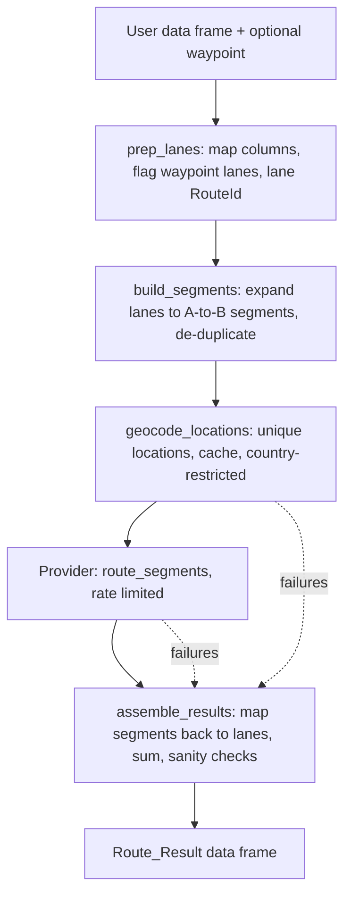

# Design Document: Phase 1 (Core Router, OpenRouteService, Waypoints, Geocoding)

## Overview

Phase 1 delivers a provider-neutral routing pipeline and one working provider, OpenRouteService (ORS), which can be developed and tested on a free account. It covers Requirements 1, 6, 9, 13 and 14, plus the key-reading parts of Requirement 7 (see Note D in `requirements.md`).

The central idea: **every provider only ever answers "route from point A to point B".** Everything else (column mapping, waypoint handling, de-duplication, geocoding, unit conversion, result assembly) is provider-neutral and lives in the package, not in a provider. This keeps providers small, makes adding Google, HERE and OSRM in Phase 3 mostly a matter of writing one adapter each, and means a provider changing its waypoint feature cannot affect results.

## Architecture



Existing `pcm_*` functions are left untouched and are not part of this pipeline (Note A). New code does not use the `pcm_` prefix.

## Components and Interfaces

### 1. `route()` (exported): the entry point

```r
route(df, waypoint = NULL, provider = truckr_get_provider(), ...)
```

- `df`: lanes with origin and destination columns, and optionally a logical `Use_Waypoint` column. The column can be omitted.
- `waypoint`: a single location applying to every lane where `Use_Waypoint` is TRUE. Accepts a zip/postal string, a "City, ST" string, a full address string, or `c(lat =, lon =)` coordinates. One waypoint value per call (Requirement 13.2, 13.4). A per-row waypoint column is a possible later extension and is out of scope.
- Argument handling is a small internal function, `resolve_waypoint_mode()`, run first so bad input fails before any API call (Requirement 13.1):

| `Use_Waypoint` column | `waypoint` | Result |
|---|---|---|
| absent | NULL | no waypoints; all lanes direct |
| present, has TRUE | supplied | TRUE lanes use the waypoint |
| present, has TRUE | NULL | error |
| present, no TRUE | NULL | all lanes direct, no error |
| present, no TRUE | supplied | all lanes direct, with a warning that the waypoint was not used |
| absent | supplied | error: add a `Use_Waypoint` column |
| present, not logical | any | error |

`resolve_waypoint_mode()` returns `mode` ("none" or "waypoint"), `use_waypoint` (a logical vector, one per row) and `waypoint` (NULL, or the parsed location). The parsed waypoint carries its `type` (`coordinates`, `address`, `zip` or `city_state`), a display `value`, and the components `street`, `city`, `state`, `zip`, `country`, `lat`, `lon`, so providers can apply their own geocoding strategy (Requirement 14.8). A bare string is classified automatically (five-digit or ZIP+4 and Canadian postal codes as `zip`; "City, ST" as `city_state`; anything else as a free-text `address`); coordinates must be named `lat` and `lon`; a named list or vector of components is also accepted, which is how to state a country explicitly. When the country is not supplied it is inferred only where unambiguous (US five-digit zips and US states as USA, Canadian postal codes and provinces as CAN) and flagged as `country_inferred`; a Mexican waypoint needs `country` stated explicitly.

NA in `Use_Waypoint` is treated as FALSE. The "absent but waypoint supplied" case is an error on purpose: silently applying a waypoint to every lane is easy to do by accident and hard to spot in the output.
- Returns the Route_Result (below).

### 2. `prep_lanes()` (internal): column mapping and lane identity

Generalizes the useful part of `pcm_prep_dataframe()`:

- Reuses `get_location_columns1()` to find origin/destination street address, city, state, zip and country columns (Requirement 9.1, 9.2, 9.5). Each side needs at least one of street address, zip or city; otherwise it stops with a message listing what was searched for and the available columns (9.3). State and country are optional; a missing country column produces a message because locations then cannot be restricted to a country (14.2). When several columns match one component (for example `orig_state` and `orig_statename`) the shortest column name is used and a message lists the others.
- Normalizes with the existing `fix.ZIP()` and `fix.CTRY()` (countries become `USA`, `MEX` or `CAN`; `fix.CTRY()` was extended to handle "U.S." and "Mexico"). Blank text becomes `NA`. Postal codes are normalized but not validated, so a malformed code such as a truncated `L8E` passes through; rejecting or flagging it is the geocoder's job (Requirement 14.5).
- Assigns a lane-level `RouteId` per distinct combination of origin, destination **and waypoint usage** (13.5), ignoring letter case, numbered in order of first appearance, preserving the original row order and joining results back onto every original row.
- A row with no street address, zip or city on one side is kept and flagged in `lane_error`, so only that lane is affected downstream (Property 9).
- A row whose origin and destination are the same location gets `same_od = TRUE`, and without a waypoint is flagged "same origin and destination" (Requirement 9.6, Property 13).
- Returns `lanes` (one row per input row, standardized `orig_*`/`dest_*` component columns), `unique_lanes` (one row per `RouteId` with a count), and the original column names used.

### 3. `build_segments()` (internal): expansion and de-duplication

Expands every lane into point-to-point segments and de-duplicates the pool by origin and destination location (13.11):

| Lane type | Segments produced |
|---|---|
| No waypoint | direct (origin to destination) |
| Waypoint | direct (origin to destination), origin to waypoint, waypoint to destination |

`build_segments()` returns four things:

- `segments`: `SegmentId` (`SEG-0001`, numbered in order of first appearance, lane by lane, direct segment first), `from_key`, `to_key`.
- `locations`: one row per distinct location used, with `location_key` and its components (`street`, `city`, `state`, `zip`, `country`, `lat`, `lon`). This is what the geocoder receives.
- `lane_segments`: one row per `RouteId` with `direct_seg`, `leg1_seg` and `leg2_seg` (NA where not applicable, and NA for lanes flagged in `lane_error`).
- `waypoint_key`: the key of the waypoint location, or NA.

A location's key is built from all five components (`street|city|state|zip|country`), upper-cased with spaces squeezed, for example `"|LAREDO|TX|78040|USA"` (empty street) or `"|||78040|USA"` (zip and country only), with unknown parts left blank; a coordinate location is keyed `COORD|lat|lon` rounded to five decimals. Because every component is in the key, the same place written with different capitalization is one location, two street addresses in one city are two, and a location known only by zip is different from the same zip with a city (they may geocode differently, so they are looked up separately).

Segments are directional: A to B and B to A are separate segments, since routes can differ. Treating them as one would save requests on quota-limited providers and is a possible later optimization, but it is not done in Phase 1. **Same origin and destination (Requirement 9.6).** `prep_lanes()` marks a lane `same_od` when its normalized origin and destination keys are identical. Without a waypoint the lane is flagged in `lane_error` as "same origin and destination" and gets no segments, so no request is made for it. With a waypoint it is not an error: it gets its two legs (out to the waypoint and back) but no direct segment (`direct_seg` is NA). Separately, `segments` has a `same_place` column that is TRUE for a zero-length segment, which happens only when a waypoint equals the lane's origin or destination; the request layer never sends such segments, and result assembly treats their distance and duration as 0. Limitation: only locations that normalize to the identical key are detected, so the same place written two ways (zip in one column, city in the other) is not caught here; two points that geocode to nearly identical coordinates are a possible later check.

Example: 25 lanes from Mexico City that all pass through Laredo produce one "Mexico City to Laredo" segment, not 25.

### 4. `geocode_locations()` (internal): coordinates with caching

- Input: the unique location keys appearing in the segments table.
- Coordinates pass through unchanged (14.1). Everything else is looked up through the provider's geocoder, restricted to the location's country (14.2).
- De-duplicated before any call (14.3). Results cached in an in-session environment, with an optional on-disk cache under `tools::R_user_dir("truckR", "cache")` (14.4). The key includes provider name so caches are not mixed.
- Each result records coordinates, a match type/confidence and an error if any (14.5, 14.6). Failed or low-confidence locations never stop the run.

### 5. Provider interface

A provider is a named list of functions, registered with `register_provider()` (Requirement 1.5) and validated at registration (1.2):

| Function | Purpose |
|---|---|
| `geocode(location)` | takes a location as a list of whatever components exist (street address, zip, city, state, country) and chooses its own strategy; returns `lon`, `lat`, match layer, error |
| `route_segment(from, to)` | one pair of coordinates to `distance_m`, `duration_s`, error |
| `validate_credentials()` | TRUE/FALSE or an error with guidance |
| `limits` | requests per minute used for throttling |

Unit conversion to miles and hours is done once, centrally, after the provider returns meters and seconds, so providers never convert (Requirement 1.3).

### 6. ORS provider (`provider_ors`)

Endpoint details below were first taken from ORS community documentation and then confirmed with live calls using the maintainer's key (see "Spike results"). Items marked unverified were not tested.

**Spike results (live, with the maintainer's key):**
- Authentication works: directions use the `Authorization` header; geocoding accepted the key as an `api_key` query parameter. Both returned HTTP 200.
- `driving-hgv` routes returned distance in meters and duration in seconds as expected. Measured: Laredo to San Antonio 159 mi; Mexico City to Laredo 694 mi (13.9 h); Laredo to Los Angeles 1,407 mi (27.5 h); Mexico City to Los Angeles direct 1,929 mi (38.2 h). Waypoint check: 694 + 1,407 = 2,101 mi through Laredo versus 1,929 direct, a plausible 172 mi detour.
- US postal codes geocode correctly (`78040` to Laredo, `78201` to San Antonio, `90001` to Los Angeles area) with `boundary.country`.
- **Mexican postal codes do not work reliably.** `06600` with `boundary.country=MX` returned no match. A free-text search "Ciudad de Mexico 06600" returned a street address numbered 6600 on Avenida Tlahuac, with `confidence` of 1 and `match_type` "exact". The confidence field therefore cannot be trusted as a quality signal. City and state search works ("Mexico City", "Monterrey, Nuevo Leon" both matched at the locality level).
- Rate-limit headers on responses show a limit of **100 geocoding requests and 200 directions requests per window of 24 hours**, not the 2,000 per day the account dashboard is reported to show (forum users report the same mismatch). Unverified: whether the header numbers or the dashboard numbers are enforced.

- Routing: `POST https://api.openrouteservice.org/v2/directions/driving-hgv` with body `{"coordinates": [[lon, lat], [lon, lat]]}`. Coordinates are **longitude first**. The response summary carries distance in meters and duration in seconds. The key is sent in the `Authorization` header.
- Geocoding: `GET https://api.openrouteservice.org/geocode/search` with `text`, optional `layers` (for example `postalcode`), `boundary.country`, and `size=1`.
- Key: read from `TRUCKR_ORS_API_KEY` at call time (Requirement 7.1, 7.3); never stored in the package, a closure or a cache. `truckr_has_key("ors")` reports TRUE/FALSE (7.4).
- Throttling: spaces requests to stay under a configurable requests-per-minute (6.5; forum sources report 40 per minute, not tested). The provider reads the `x-ratelimit-limit` and `x-ratelimit-remaining` headers from each response, and stops cleanly before the quota is exhausted, returning what it has with the remaining lanes marked as not yet routed (see Risk 2).
- Errors: HTTP 429 and 5xx are retried with exponential backoff (default 3 attempts); other 4xx are not retried. A failed segment returns NA with the reason (Requirement 6.3). Full retry and batching features are Phase 2; Phase 1 has only this minimum.
- Profile: `driving-hgv`. Truck dimension options (weight, height) are not exposed in Phase 1.

### 7. `assemble_results()` (internal): back to lanes

For each lane, using its segment ids:

- `distance_direct`, `duration_direct` come from the direct segment.
- `distance_routed`, `duration_routed` equal the direct values for non-waypoint lanes, or the sum of the two leg segments for waypoint lanes (13.9). If either leg failed, they are NA with the error recorded (13.9).
- `has_waypoint` is TRUE/FALSE for every lane (13.6).
- Only when at least one lane uses a waypoint, the extra columns are added: waypoint value and type, `detour_added`, `detour_duration_added`; all NA for non-waypoint lanes (13.8).
- Sanity check (13.10): flags lanes where routed is shorter than direct beyond 0.5%, which suggests a mis-geocoded waypoint.
- Results are joined back to the user's original rows, so row count and order match the input.

## Data Models

### Route_Result (always present columns)

| Column | Type | Notes |
|---|---|---|
| (original input columns) | as supplied | unchanged, original order |
| `RouteId` | chr | lane identity |
| `distance_direct` | dbl | miles |
| `distance_routed` | dbl | miles; equals direct when no waypoint |
| `duration_direct` | dbl | hours |
| `duration_routed` | dbl | hours; equals direct when no waypoint |
| `has_waypoint` | lgl | for quick filtering |
| `provider_name` | chr | for example `"ors"` |
| `route_error` | chr | NA when fine; otherwise the reason |
| `geocode_flag` | chr | NA when fine; otherwise low-confidence or failed location note |

### Added only when any lane uses a waypoint (NA otherwise)

`waypoint_value`, `waypoint_type`, `detour_added` (miles), `detour_duration_added` (hours).

## Correctness Properties

These are statements that must hold for every input, not just the examples we happen to test. Each is checked by one or more tests (see Testing Strategy), mostly with a fake provider so no API quota is used.

### Property 1: Row preservation
The Route_Result has exactly the rows of the input, in the same order, with the original columns unchanged.

**Validates: Requirements 1.3, 9.4**

### Property 2: Always-present columns
Every Route_Result contains `distance_direct`, `distance_routed`, `duration_direct`, `duration_routed` and `has_waypoint`, whether or not any lane uses a waypoint.

**Validates: Requirements 13.6**

### Property 3: No waypoint, no extra columns
When no lane uses a waypoint, the Route_Result contains none of `waypoint_value`, `waypoint_type`, `detour_added` or `detour_duration_added`.

**Validates: Requirements 13.7**

### Property 4: Non-waypoint lanes
For a lane that does not use a waypoint, `has_waypoint` is FALSE, `distance_routed` equals `distance_direct`, `duration_routed` equals `duration_direct`, and any waypoint-only columns are NA.

**Validates: Requirements 13.6, 13.8**

### Property 5: Waypoint lanes are the sum of two segments
For a lane that uses a waypoint, `distance_routed` and `duration_routed` equal the sum of the origin-to-waypoint and waypoint-to-destination segment values, and `detour_added` equals `distance_routed - distance_direct`. If either segment failed, `distance_routed` and `duration_routed` are NA and the lane carries an error.

**Validates: Requirements 13.8, 13.9**

### Property 6: Lane identity
Two lanes that share an origin, destination and waypoint usage share a RouteId. Two lanes that differ only in waypoint usage have different RouteIds.

**Validates: Requirements 9.4, 13.5**

### Property 7: Each distinct segment is requested at most once
Across the whole run, the number of provider routing requests is at most the number of distinct (from location, to location) segments, no matter how many lanes use a segment. The same holds for geocoding: at most one request per distinct location.

**Validates: Requirements 13.11, 14.3**

### Property 8: Repeat runs are free
Running the same input a second time, with the cache intact, makes zero provider requests and returns identical results.

**Validates: Requirements 14.4**

### Property 9: Failures stay local
A location that cannot be geocoded, or a segment that fails, changes only the lanes that depend on it. Every other lane's result is identical to what it would have been without the failure.

**Validates: Requirements 14.5, 13.9**

### Property 10: Bad arguments fail before any request
Invalid combinations of the `Use_Waypoint` column and the `waypoint` argument raise an error before the first provider request or cache write.

**Validates: Requirements 13.1**

### Property 11: Direct and routed sanity check
For a waypoint lane, `distance_routed` is never reported as more than 0.5% shorter than `distance_direct` without the lane being flagged.

**Validates: Requirements 13.10**

### Property 12: The key never leaks
The API key never appears in any message, warning, error, cache file or returned value.

**Validates: Requirements 7.5**

### Property 13: No self-routes
No provider request is ever made for a route whose start and end are the same location. A lane with the same origin and destination and no waypoint is returned with NA distances and the error "same origin and destination". With a waypoint it is routed through the waypoint and back, and the direct segment is not requested.

**Validates: Requirements 9.6**

## Error Handling

- No provider configured, missing key, or inconsistent waypoint arguments: stop immediately with a clear message naming the fix.
- Per-location and per-segment problems never stop the run. They become NA values plus a message in `route_error` / `geocode_flag` on every affected lane (13.9, 14.5).
- Progress is reported with `message()`, not colored `cat()` as in the older code.

## Testing Strategy

No test infrastructure exists yet; Phase 1 adds `testthat` (3rd edition) to Suggests.

- **Pure logic, no network (most tests):** `prep_lanes`, `build_segments` de-duplication (including the "25 lanes through Laredo" case), `assemble_results` math, unit conversion, the routed-versus-direct sanity check, and `Use_Waypoint`/`waypoint` argument validation. These use `df_route_samples` and `df_route_unclean`.
- **Provider logic, mocked network:** all HTTP goes through a single internal function per provider (for example `ors_request()`). Tests replace it with `testthat::local_mocked_bindings()` returning saved JSON fixtures in `tests/testthat/fixtures/`. This needs no extra dependencies and works with the package's current use of `httr`.
- **Live tests:** a small number, wrapped in `skip_on_cran()` and a skip if `TRUCKR_ORS_API_KEY` is not set, so CRAN checks never need network access (Requirement 10.5).
- A **golden check** for waypoints: routed distance for a lane through a waypoint should be at least the direct distance, and Mexico City through Laredo to Los Angeles should be materially longer than direct.

## Risks and Open Questions

1. **ORS maximum route distance: retired for the lanes tested.** The spike returned a 3,104 km (1,929 mi) Mexico City to Los Angeles route with no error, so the longest lanes in your example work, including as a single direct segment. Not tested: lanes longer than about 3,400 km (for example Mexico to the US northeast or Canada), which remain unverified.
2. **Quota is the main constraint (new, highest risk).** Response headers report **200 directions and 100 geocoding requests per 24 hours**. A single waypoint lane can need up to 3 directions requests (direct plus two legs). Practical consequences, all pulled forward into Phase 1:
   - Segment de-duplication (Requirement 13.11) and location de-duplication (Requirement 14.3) are essential, not optimizations.
   - The persistent on-disk cache (Requirement 14.4) is required in Phase 1, for both geocodes and route segments, keyed by provider and profile. Re-running a job then spends no quota on work already done.
   - `route()` checks the planned request count against the remaining quota before starting, and says so up front ("this run needs 340 directions requests; about 196 remain"). If it exceeds the quota, it processes as many segments as fit, caches them, and returns the remaining lanes as `route_error = "quota exhausted; re-run after reset"`, so a second run the next day finishes the job.
   - Geocoding at the city/state level where the provider supports it (see Risk 3) collapses many lanes onto fewer locations.
   - **Development sizing:** `df_route_samples` has 80 rows, 74 distinct lanes and 77 distinct locations (countries CA, MX, US); `df_route_unclean` has 74 lanes and 82 locations. One full run therefore needs about 74 directions and 77 geocoding requests, which fits in a day, but only once. These samples have almost no repeated lanes, so they will not exercise de-duplication; that is tested with synthetic data in mocked tests. The cache is what makes repeated development runs affordable. The earlier spike already used 7 geocoding and 4 directions requests.
   - **Production sizing:** several thousand lanes at 200 directions per day is days to weeks of runtime for ORS alone, if the header limits are what is enforced. This does not block development. It does mean a second provider (or a paid or self-hosted option) should be chosen before the first production-scale run.
   - If the daily limit proves too low for real jobs, the Phase 3 providers (OSRM self-hosted or public, Google, HERE) are the relief valve, and the provider-neutral design makes that a small change.
3. **Geocoding quality, especially Mexico.** The spike showed that Mexican postal codes fail or mis-match, and that `confidence` reports 1 for a wrong match. Design response:
   - **The geocoding strategy belongs to the provider, not the package.** The package passes each provider every component it has for a location (zip, city, state, country; any may be missing), and the provider decides how to use them. A later provider that geocodes Mexican postal codes well can use zip first; ORS uses what the spike showed works. The cache key includes the provider name and the exact components used, so strategies never mix.
   - **Street addresses (occasional):** when a location has a street address, the provider tries it first, combined with city, state and country. The result is accepted only if it comes back at the address level; otherwise the provider falls back to the coarser city/zip lookup and sets `geocode_flag` to say so, so lanes with reduced precision stand out. The street address is part of the location key, so different addresses in one city stay distinct rather than collapsing into a single location. The existing column matcher already recognizes an address column through `pcm_address_regexes$StreetAddress` (Requirement 9.5). How well ORS matches US, Mexican and Canadian street addresses is untested; the first geocoding build task tests a handful.
   - **ORS strategy:** US locations use the postal-code layer when a zip is present. Mexican (and, until tested, Canadian) locations use city, state and country when present. A Mexican location with only a zip is **not** sent as a free-text search, since that produced a wrong match in the spike; it is returned as a failed location with the reason "zip-only location not supported by this provider", so the lane gets NA distances and an explicit error instead of a wrong distance.
   - Do not rely on `confidence`. Instead validate each result: the returned layer should be `locality` or `postalcode` (not `address`), and the returned region/country should match the expected state and country; mismatches are flagged in `geocode_flag` and the lane's distances are returned but marked for review.
   - Canadian postal codes (for example `L8E2B4`, which `fix.ZIP()` spaces to `L8E 2B4`) are untested; the first build task includes testing them against your sample data.
4. **Country codes.** Your data uses `"CA"` for Canada, which `fix.CTRY()` maps to `"CAN"`. Geocoder country filtering must use the normalized form to avoid confusion with California.
5. **Dependencies.** `rlang` is used in the package but missing from `Imports`; Phase 1 adds it (this also clears an existing check warning).
6. **Waypoint and the 0.5% check.** The segment-sum can differ slightly from a true through-route; this is accepted (Requirement 13) and the sanity check guards only against gross errors.

## Spike status

The verification spike (key works, long routes work, rate-limit headers captured, Mexican postal code problem found) is complete; results are recorded in section 6. It used 7 geocoding and 4 directions requests of the 24-hour quota (the final headers showed 93 and 196 remaining).
