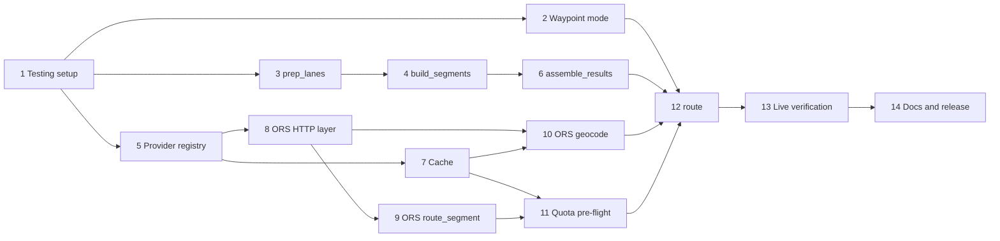

# Implementation Plan: Phase 1 (Core Router, OpenRouteService, Waypoints, Geocoding)

## Overview

This plan implements Phase 1 from `design.md`. Tasks are ordered so that the pure logic (no network, no API quota) is built and tested first, then the provider plumbing, then live API work, which is kept to a minimum because the ORS free quota is limited: 2,000 directions per 24 hours measured on `api.heigit.org`, and 3,000 geocoding requests per 24 hours (see Risk 2 in the design).

Working rules for every task:

- Work one task at a time and make one git commit per task (or per small group), using the author `Scott Jackson <sjackson1997@gmail.com>`.
- New code does not use the `pcm_` prefix. Existing `pcm_*` functions are left untouched (Note A).
- Use `pkg::fn()` namespacing, roxygen2 docs with `@param`, `@return` and `@examples` on every exported function, and `message()` (not colored `cat()`) for progress.
- The API key is read from `TRUCKR_ORS_API_KEY` at call time only. It is never printed, logged, cached or written to any file.
- After each task run `devtools::document()` and `devtools::test()`; run `devtools::check()` at the checkpoints. The three pre-existing documentation warnings are expected until Phase 4, except the `rlang` one, which Task 1 clears.
- Live-quota budget is tracked in each task that uses it. Live calls are made only in the tasks marked LIVE.

## Tasks

- [x] 1. Set up testing and fix package dependencies
  - Run `usethis::use_testthat(edition = 3)`; add `testthat (>= 3.0.0)` to Suggests.
  - Add `rlang` to Imports (it is already used by `pcm_prep_dataframe()`), clearing the "import not declared" check warning.
  - Add a trivial passing test to confirm the harness runs; run `devtools::test()` and `devtools::check()`.
  - Update `renv` with `renv::snapshot(dev = TRUE)` so `testthat` (a Suggests package) is locked too; a plain `renv::snapshot()` skips Suggests in this project.
  - Done when: tests run, the `rlang` warning is gone, and renv reports no issues.
  - _Requirements: 10.2_

- [x] 2. Implement `resolve_waypoint_mode()` (argument validation)
  - Internal function taking `df` and `waypoint`; returns a normalized list: which rows use a waypoint (logical vector, NA treated as FALSE) and the parsed waypoint (type: zip, city/state, address or coordinates).
  - Implement every row of the table in the design: absent/NULL, present with TRUE, TRUE with no waypoint (error), no TRUE with no waypoint (all direct), absent column with a waypoint (error asking for `Use_Waypoint`), non-logical column (error).
  - Tests for each case, including NA handling and error messages.
  - Done when: all cases covered by passing tests and no network is used.
  - _Requirements: 13.1, 13.2, 13.4_

- [x] 3. Implement `prep_lanes()` (column mapping and lane identity)
  - Internal function that reuses `get_location_columns1()` to find origin and destination columns, including the optional street address component.
  - Stop with a clear list of the missing components when required ones (city/state/zip/country as available per location) cannot be matched.
  - Normalize with `fix.ZIP()` and `fix.CTRY()`; assign a lane-level `RouteId` per distinct origin, destination and waypoint-usage combination; keep the original rows and order so results can be joined back to every row.
  - Tests with `df_route_samples` and `df_route_unclean` (including the mixed country codes such as `U.S.`, `CAD`, `MEX`), a case with a street address column and a case without, and a case where the same origin and destination differ only in waypoint usage.
  - Done when: tests pass and the function returns the same lane count as the measured samples (74 distinct lanes in `df_route_samples`).
  - _Requirements: 9.1, 9.2, 9.3, 9.4, 9.5, 13.5_

- [x] 4. Implement location keys and `build_segments()` (expansion and de-duplication)
  - Internal location key builder: normalized string from all available components (street address, zip, city, state, country) so the same place written two ways de-duplicates, while two street addresses in one city stay distinct.
  - `build_segments()` expands lanes into point-to-point segments: direct only for non-waypoint lanes; direct plus origin-to-waypoint plus waypoint-to-destination for waypoint lanes. De-duplicate the pool by from/to location key and keep a mapping from each lane to its segment ids.
  - Synthetic tests: 25 lanes from one Mexican origin through one Laredo waypoint to different California destinations must produce exactly one "origin to Laredo" segment; two lanes sharing an origin and destination produce one direct segment; mixed waypoint and non-waypoint lanes share a direct segment where applicable.
  - Done when: segment counts match hand-calculated expectations in all synthetic cases.
  - _Requirements: 13.3, 13.9, 13.11, 14.3_

- [x] 5. Implement the provider registry and credential helpers
  - `register_provider()` validating the interface (`geocode`, `route_segment`, `validate_credentials`, `limits`); minimal `truckr_set_provider()`, `truckr_get_provider()`, `truckr_list_providers()`; stop with a clear message when no provider is configured or an unregistered name is requested.
  - `truckr_has_key(provider)` reading `TRUCKR_{PROVIDER}_API_KEY`; internal key getter that stops with a clear message naming the missing variable and how to set it, and never echoes the key.
  - Tests with a fake provider (no network), including rejection of providers missing a required function.
  - Done when: registering a valid fake provider works, invalid ones fail with clear messages, and no key value appears in any message or test output.
  - _Requirements: 1.2, 1.4, 1.5, 7.1, 7.3, 7.4, 7.5, 8.1, 8.3, 8.4, 8.5_

- [x] 6. Implement unit conversion and `assemble_results()`
  - Central conversion from meters to miles and seconds to hours (providers never convert).
  - `assemble_results()` maps segment results back to lanes and builds `distance_direct`, `distance_routed`, `duration_direct`, `duration_routed`, `has_waypoint`, `provider_name`, `route_error` and `geocode_flag`; routed values are the sum of the two legs for waypoint lanes and equal to the direct values otherwise; NA with an error message if either leg failed.
  - Add the waypoint-only columns (`waypoint_value`, `waypoint_type`, `detour_added`, `detour_duration_added`) only when at least one lane uses a waypoint, NA for other lanes; add no extra columns otherwise.
  - Sanity check: flag lanes where routed is shorter than direct beyond 0.5% in distance or duration.
  - Same-place lanes (Requirement 9.6): a lane flagged "same origin and destination" in `lane_error` gets NA distances and durations and that text in `route_error`. A same-place lane that uses a waypoint gets `distance_routed`/`duration_routed` from its two legs, NA for `distance_direct`/`duration_direct` and for the detour columns, and a `route_error` note saying the direct distance does not apply. A segment with `same_place` TRUE has distance and duration 0 without any request.
  - Join back to the original rows so row count and order match the input.
  - Tests with hand-built segment results, covering: no waypoints, mixed lanes, a failed leg, a failed direct segment, the sanity-check trigger, and row order preservation.
  - Done when: all cases pass and the always-present columns exist in every case.
  - _Requirements: 1.3, 13.6, 13.7, 13.8, 13.9, 13.10_

- [x] 7. Implement the cache layer
  - Two layers (design, Component 8): an in-memory session cache and a disk cache under `tools::R_user_dir("truckR", "cache")`, for both geocode results and route-segment results. Lookup order is memory, then disk, then the provider. The disk file is read into memory once per session; new answers go to memory at once and are written to disk every 25 new answers and when a run ends or stops early (`on.exit`), using a temporary file that is renamed so a crash cannot damage the cache. The disk layer can be switched off with a `cache` setting.
  - Keys include provider name, profile (for routes) and the exact location components used, so providers and strategies never mix. No API key is ever stored.
  - Each entry records when it was obtained. Entries older than 120 days (setting `max_age_days`, default 120) are treated as missing, requested again, replaced, and dropped from the file at the next write.
  - Failures: temporary failures (network, timeout, 429, 5xx, quota exhausted, or any failure the provider does not mark `error_permanent`) are never stored. A failure marked permanent is remembered in memory only, for the current session, and never written to disk.
  - Helpers to inspect and clear the cache (`truckr_cache_info()` reports path, entry counts, oldest entry, expired count and size; `truckr_cache_clear()` clears memory, disk or both, optionally for one provider).
  - Tests using a temporary cache directory and a fake clock (no waiting): hit, miss, persistence across a simulated new session, key separation by provider, an entry 119 days old is used and one 121 days old is refreshed, expired entries are dropped on write, a temporary failure leaves no entry, a permanent failure stays in memory only, a run that stops early keeps what it obtained, and a corrupted cache file is ignored with a message and rebuilt.
  - Done when: a second identical request is served without calling the provider function (verified with a counting fake provider) and every property listed above has a passing test.
  - _Requirements: 14.3, 14.4, 14.5, 14.11, 14.12, 14.13_

- [x] 8. Implement the ORS HTTP layer
  - A single internal function (for example `ors_request()`) through which all ORS traffic passes, so tests can replace it with saved fixtures.
  - Reads the key from `TRUCKR_ORS_API_KEY` at call time; sends it in the `Authorization` header for directions and the `api_key` parameter for geocoding (as confirmed in the spike).
  - Reads `x-ratelimit-limit`, `x-ratelimit-remaining` and `x-ratelimit-reset` from responses and exposes them; retries network errors, HTTP 5xx and rate-limit 429s with exponential backoff (3 attempts in total by default) with `message()` notices; does not retry other 4xx; spaces requests under a configurable requests-per-minute.
  - Classify every failure as temporary or permanent so the cache can decide what to keep (Requirement 14.13): network errors, timeouts, 429, 5xx and exhausted quota are temporary; a request the provider understood and rejected as unanswerable (for example no match found) is permanent. Anything unclear is temporary. Pass every error message through `redact_key()`.
  - Tests with a mocked `httr` layer: success, 429 then success, 5xx exhausting retries, 4xx not retried, missing key, and the temporary/permanent classification for each case.
  - Done when: all behaviors pass with no network calls.
  - _Requirements: 6.5, 7.3, 11.1, 11.3, 11.4_

- [x] 9. Implement ORS `route_segment()` with mocked tests
  - POST to `/openrouteservice/v2/directions/driving-hgv` on `api.heigit.org` with `[lon, lat]` ordering and geometry and instructions switched off; return `distance_m`, `duration_s` and any error message (HTTP error text parsed from the response body), plus `error_permanent` and `error_kind`. Coordinates are checked by `lonlat_vector()`, which uses names when present and rejects out-of-range values (the usual sign of a latitude/longitude swap).
  - Service addresses: the package uses only `api.heigit.org` (directions under `/openrouteservice`, geocoding under `/pelias/v1`), as settings (`truckr.ors_directions_url`, `truckr.ors_geocode_url`). ORS's earlier address is retired and not supported (history note in the design). Requirement 6.6.
  - Three response fixtures captured live from `api.heigit.org` under `tests/testthat/fixtures/`: success, a point with no road nearby (404, ORS code 2010) and a route over the length limit (400, ORS code 2004, 6,000 km). Three directions requests were used.
  - Tests parse the fixtures, confirm the request body byte for byte, confirm unit handling, and confirm how each result is cached.
  - Done when: parsing tests pass offline and fixtures are committed with no key or personal data in them (checked: the key does not appear in any fixture). Requirement 6.7.
  - _Requirements: 6.1, 6.2, 6.3, 6.6, 6.7_

- [x] 10. Implement ORS `geocode()` strategy and test street addresses and Canadian postal codes
  - Implemented the provider-owned strategy (`R/ors_geocode.R`): street address, then postal code (US and Canada only), then city with state; Mexican zip-only locations return a failed location with the reason "zip-only location not supported by this provider" and Mexican postal codes are never sent. Mexican cities are searched with the full state name, translated from the code in the data (`R/states.R`, all 32 states and their common abbreviations), with a second lookup of the city name alone checked against the state.
  - Every candidate is judged instead of trusting `confidence` (exact match, right level, right name, right country, state not provably different). A candidate that fails a check but is on the right level and in the right country is "doubtful": it is used only if no lookup gives a clean result, then the least doubtful one is returned marked "CHECK:" with the reasons (the maintainer's preference, Requirement 14.14). `options(truckr.geocode_doubtful = "reject")` returns a failure instead. A candidate on the wrong level or in another country is never returned.
  - LIVE: 22 geocoding requests on `api.heigit.org` (budget was about 15; the limit there is 3,000 a day, measured). Findings and the saved fixtures (`ors_geocode_*.json`) are in the design under "ORS geocoding as built". Canadian postal codes work; Mexican postal codes do not; street addresses work in all three countries.
  - Tests (offline, using the live fixtures): strategy selection for each combination of components, request contents, fallback flagging, Mexican zip refusal and that a Mexican zip is never sent, state names and codes, ambiguity, wrong-state and wrong-name rejection, failures of the request passed through without a coarser fallback, and how each result is cached.
  - Done when: offline tests pass and the live findings are written into the design document.
  - _Requirements: 6.4, 14.1, 14.2, 14.5, 14.6, 14.8, 14.9, 14.10, 14.14_

- [x] 11. Implement the quota pre-flight and graceful stop
  - Built as a shared engine, `cached_requests()` (`R/requests.R`), that Task 12 will use for geocoding as well as routing: saved answers first (an entry older than 120 days counts as not saved), then one request at a time, with the number of requests needed and the quota remaining reported up front with `message()` (Requirement 12.5). The remaining quota comes from a new optional provider function, `remaining_quota(kind)`; for ORS it is the last rate-limit header seen, ignored once its 24-hour window has ended (`ors_remaining_quota()`). With no known quota the run goes ahead and respects it as soon as it becomes known.
  - If the run exceeds the quota, it requests as many as fit, saves them, stops without an error, and the items left over carry the error "quota exhausted; re-run after reset", so a later run completes the job without repeating anything (Requirement 12.6). It also stops on a "quota exhausted" answer, on a rejected API key, and after 5 temporary failures in a row (Requirement 12.7); the cache is written however the run ends.
  - `route_segments()` applies the engine to the segments from Task 4 and returns the table `assemble_results()` needs. Zero-length segments (`same_place`) are left out and never sent to a provider (Requirement 9.6); ends with identical coordinates get distance 0 without a request; ends that could not be geocoded give a clear error without a request.
  - Tests with a fake provider that reports a small quota: the run stops at the limit and never goes over it, results are cached, a second run finishes only the remaining segments, and the final table shows the quota error on exactly the lanes that were not routed (including a waypoint lane whose second leg ran out). Also: failures in a row, a rejected key, errors inside the provider's function, progress messages, and what is and is not saved after a failure.
  - Done when: the stop-and-resume behavior is verified offline. (It is: 1,408 tests pass.)
  - _Requirements: 6.5, 9.6, 11.2, 12.2, 12.3, 12.4, 12.5, 12.6, 12.7_

- [ ] 12. Implement `route()` and the `provider_ors` registration
  - The exported entry point: validate arguments (Task 2), prepare lanes (Task 3), build segments (Task 4), geocode unique locations (Tasks 7 and 10), route unique segments (Tasks 7, 9 and 11), assemble results (Task 6).
  - Register the ORS provider at package load; `route()` uses the active provider.
  - Pass each location's geocode `flag` to `assemble_results()` as `location_flags`, and extend `assemble_results()` with the always-present logical column `geocode_check`: TRUE for a lane when any of its locations (origin, destination, waypoint) has a flag starting "CHECK:", FALSE otherwise (Requirement 14.15). Add it to the always-present column lists in the tests.
  - Full offline end-to-end tests with a fake provider: `df_route_samples` with no waypoint column; a Mexico-to-California fixture with `Use_Waypoint` and a Laredo waypoint; a lane with a failed geocode; a lane with a failed leg.
  - Done when: offline end-to-end tests pass, row count and order match the input, and the always-present columns exist in every scenario.
  - _Requirements: 1.1, 1.3, 1.4, 6.1, 9.4, 12.1, 12.2, 13.1, 14.15_

- [ ] 13. LIVE end-to-end verification on a small subset
  - Run `route()` against about 10 lanes from `df_route_samples` plus 2 Mexico-to-California fixture lanes with a Laredo waypoint (budget: about 25 directions and 25 geocoding requests, fewer with caching; check remaining quota first and stop if under budget).
  - Check by hand: distances look plausible, `distance_routed` is at least `distance_direct` on waypoint lanes, durations are consistent with distances, `has_waypoint` is correct, and a second identical run uses no new requests.
  - Record any surprises in the design document.
  - Done when: results are verified and written up, and a second run is served entirely from cache.
  - _Requirements: 6.1, 13.6, 13.7, 13.8, 13.10, 14.4_

- [ ] 14. Documentation and release hygiene
  - Complete roxygen documentation (`@param`, `@return`, `@examples` wrapped in `\dontrun{}` for anything needing the API) for every new exported function.
  - Add a short `README` section showing key setup (`.Renviron`), a basic `route()` call, and a waypoint example, plus a note that ORS results are licensed CC-BY-SA 4.0 with the attribution "openrouteservice.org | OpenStreetMap contributors", which matters if results are shared outside the company.
  - Run `devtools::document()` and `devtools::check()`; confirm no new warnings or notes.
  - Update `TODO_package_plan.md` to remove the items that are now done and reflect the new priorities.
  - Rebuild and reinstall into the global library so `library(truckR)` has the new functions; run `renv::snapshot(dev = TRUE)`.
  - Done when: the check is clean apart from the known Phase 4 documentation warnings and a fresh R session can call `route()` on a small example.
  - _Requirements: 10.1, 10.4, 10.5, 10.6_

## Checkpoints

- After Task 6: pure logic is complete and fully tested offline (no quota used). Review together.
- After Task 12: the whole pipeline works offline with a fake provider. Review together before spending live quota.
- After Task 13: Phase 1 is functionally complete. Decide whether to start Phase 2 or choose the second provider for production-scale runs (see Risk 2).

## Not in Phase 1

Credential-setting helpers and keyring support, provider options beyond defaults, full retry and batch configuration, the OSRM, Google and HERE providers, the PC Miler provider refactor, and the remaining CRAN readiness work are Phases 2 to 4 (Note D).

## Task Dependency Graph

An arrow means "must be finished before". Tasks with no arrow between them can be done in any order.



The same dependencies as waves. Waves run in order; tasks inside a wave do not depend on each other:

```json
{
  "waves": [
    { "id": 1, "tasks": ["1"] },
    { "id": 2, "tasks": ["2", "3", "5"] },
    { "id": 3, "tasks": ["4", "7", "8"] },
    { "id": 4, "tasks": ["6", "9", "10"] },
    { "id": 5, "tasks": ["11"] },
    { "id": 6, "tasks": ["12"] },
    { "id": 7, "tasks": ["13"] },
    { "id": 8, "tasks": ["14"] }
  ]
}
```

Notes on the graph: Tasks 2, 3 and 5 can start in any order once Task 1 is done. Tasks 1 to 6 need no network or API quota. The first live API calls are in Task 9.

## Notes

- **Waves are about dependencies only:** the waves above describe what is technically possible in parallel. They do not replace the review checkpoints below or the live-quota rules, so tasks are still done one at a time, and the live tasks (9, 10 and 13) should never run at the same time because they share one daily quota.
- **Status convention:** a task is marked `[x]` only when its "Done when" condition has been met and the work is committed on the `phase1-routing` branch.
- **renv and dev dependencies:** this project's renv ignores Suggests by default. Always snapshot with `renv::snapshot(dev = TRUE)` or `testthat` will drop out of `renv.lock`. `devtools` and `roxygen2` are developer tools and are intentionally not locked; install them separately when developing.
- **Live quota:** the ORS free quota (2,000 directions per 24 hours on `api.heigit.org`; 3,000 geocoding requests per 24 hours, both measured) is shared by all live tasks. Check the remaining quota before each live task (9, 10 and 13) and prefer saved fixtures over repeat calls.
- **ORS terms on storing results (checked in Task 10, partly):** an ORS team member answered on their forum (27 August 2026) that, as long as the Terms of Service are followed, results may be stored and used as one pleases; they also warned that the same query can give a different result after an update to ORS or its data, which supports the 120-day refresh. Another thread says results are licensed CC-BY-SA 4.0 (attribution: "openrouteservice.org | OpenStreetMap contributors"). The formal Terms of Service page was not read, so this is a forum answer, not a legal opinion. The disk cache stays on by default. If results are shared outside the company, the attribution and share-alike terms may apply; Task 14 adds a short note to the README.
- **Spec changes during build:** when a task reveals something that changes the design (a live finding, a decision), update `design.md` or `requirements.md` in the same commit as the code so the documents never drift from the implementation.
